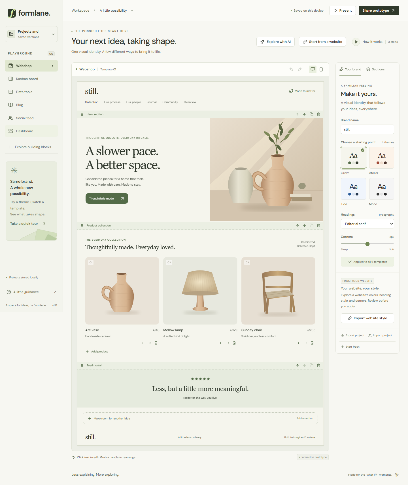

# Formlane

**One brand. A few different ways to bring it to life.**

Formlane is a browser-based visual prototyping playground for the “what if?” moments in a meeting. Explore a webshop, Kanban board, data table, blog, social feed, and dashboard with one shared visual identity. Edit the examples, rearrange sections, and present an idea while it is still taking shape.

Colombia is the repository name; the application is called Formlane.

**Deployed URL:** [formlane.netlify.app](https://formlane.netlify.app)



## Run locally

Requires Node.js 22.12 or newer and npm. From this checkout:

```powershell
npm ci
npm run dev
```

Open the local URL printed by Vite. The editor and labeled assistant example require no account, API key, database, or environment file. Fonts and illustrations are bundled locally. Website imports use same-origin endpoints to read the public URL you submit; optional AI suggestions use a server-side provider connection. Both `npm run dev` and `npm run preview` provide these endpoints locally.

## Current capabilities

- **Six templates:** webshop, Kanban, data table, [blog](https://formlane.netlify.app/?template=blog), [social feed](https://formlane.netlify.app/?template=social), and [dashboard](https://formlane.netlify.app/?template=dashboard). All support direct `?template=` URLs, browser history, mobile preview, and presentation navigation.
- **Article, post, and metric styles:** text sections can switch between plain text, editorial articles, community posts, and metric cards through “Section style”. Posts derive avatar initials from their heading. Metrics use the first body line as the figure and subsequent lines as a caption. The example figures and feed content are editable prototype data. Every style retains structural editing, movement, duplication, history, and sharing.
- **One shared brand:** four curated themes (Grove, Atelier, Tide, Mono), brand name, serif/sans headings, and adjustable corners.
- **Website style import:** choose “Start from a website”, enter a public HTTPS URL, then review detected colors, heading style, and corners before applying them to all six templates. “Where these styles came from” shows source selectors, stylesheet labels, detected values, and your current choices, with fallbacks clearly marked. Try a detected color as the accent, edit the palette, optionally rename the brand, or cancel without changing the project. Imports are undoable and survive saving, sharing, and export. The original [brand study example](https://formlane.netlify.app/examples/brand-study.html) demonstrates the review.
- **Webpage content and Markdown:** choose “Start from a website” → “Page content”. Read a public page, review its sections, then add selected text and tables to the current template in one undoable step. Existing content and themes stay intact. Copy or download Markdown without changing the prototype, even when the page is full. The [studio notes example](https://formlane.netlify.app/examples/studio-notes.html) provides original content to try.
- **Paste Markdown:** in “Page content”, choose “Paste Markdown”, paste a document (or use the meeting notes example), and prepare its sections. Parsing runs in your browser, with no API calls or referenced link/image requests. Headings, lists, tasks, quotes, code, and GFM tables become editable text/table sections. Copy/download retains the original Markdown.
- **Choose what to bring:** search headings, text, or table cells, filter text/tables, and preview complete sections before adding them. Hidden selections stay selected and are counted. “Select matching” fills remaining spaces without dropping other selections; imports retain source order. Table previews scroll within the dialog.
- **Inline editing:** edit headings, descriptions, products, table headers/cells, Kanban column titles/cards/tags/assignees, and testimonials. Enter commits, Escape cancels, and Shift+Enter adds a line in multiline fields. Paste becomes plain text.
- **Structural editing:** add/delete products, table rows/columns, Kanban columns/cards, and six kinds of sections. Move products with arrows; move cards with drag handles or their move menus. Sections support dragging, keyboard dragging, move arrows, duplication, and deletion.
- **Undo/redo:** 50 project-wide history steps, with Ctrl/⌘ Z, Ctrl/⌘ Shift Z, and Ctrl/⌘ Y outside text fields. History lasts for the current session.
- **Previews and presentation:** responsive layouts, mobile-width preview, and a presentation mode without editing controls. Escape returns to the editor.
- **Named projects:** “Projects and saved versions” opens a device-local library. Create a fresh project, duplicate the current direction, switch projects, or export/remove an older one. Rename the current project in the top bar. Switching flushes pending edits and starts a separate undo history. Existing single-project saves migrate automatically.
- **Saved versions:** name a checkpoint before a review, then restore it across all six templates and the shared brand. Restoration is one undoable change. Versions survive reloading and can be exported individually; removing projects or versions requires confirmation.
- **PDF handouts:** “Share prototype” → “Take it to the meeting” prepares the current template or all six. “Print / save PDF” opens the browser print dialog; select Save as PDF, A4 portrait, default scale, background graphics, and no browser headers/footers. Text remains selectable, illustrations stay vector, and long tables repeat their headers across pages. Very wide tables wrap cells to fit. Pagination depends on the browser and print settings; PDF is a handout, while project files remain editable.
- **Local autosave:** working projects stay in this browser. Storage errors and observed stale-tab conflicts are visible. Unreadable saved data is protected from automatic overwrites; explicitly recovering a corrupt library keeps its original bytes in a separate recovery key first.
- **Portable projects:** export/import a validated, versioned `.formlane.json` file. Imports and confirmed start-fresh operations can be undone.
- **Earlier v1 projects:** old saves, files, and snapshot links gain the new starter pages while retaining original content, IDs, and brand settings. Normalized projects save all six pages. Malformed supplied pages are rejected rather than replaced; the 750 KB limit also applies after expansion. A legacy save that would exceed it opens the protected recovery flow, leaving the saved copy untouched.
- **Shareable snapshots:** compressed project data travels in the URL fragment. A snapshot opens without replacing the recipient’s saved project; “Keep this copy” adds a separate project to their library. Links contain the current draft, without its version history, and are snapshots rather than live collaboration.
- **Reviewed AI suggestions:** “Explore with AI” accepts a request for copy, section order, text additions/removal, table headers/cells/rows, or a shared brand/theme. Choose the current template or just the selected section. Review exact before/proposed values, then apply the whole proposal in one undoable change. Nothing applies automatically. Unsupported or invalid proposals leave the draft intact; editing the request, cancelling, closing, or changing the project discards stale proposals. Advice-only responses can ask a clarifying question without edits.
- **Honest unconfigured mode:** AI suggestions remain disabled until a server-side provider is enabled. “Try an example · no AI request” demonstrates the same review/apply/undo workflow using a clearly labeled built-in proposal. It makes no provider request and works offline after the app has loaded.
- **A guided introduction:** a three-step tour explains the actual tools and their limits.

Templates are visual examples. Store checkout, email delivery, real customer records, and production task management are outside this prototype.

## Check it

```powershell
npx playwright install chromium
npm run check
```

`npm run check` runs unit tests, TypeScript checks, the production build, and Chromium end-to-end tests against that production bundle. Browser tests cover editing, persistence, theme propagation, table structure, card movement, pointer and keyboard drag-and-drop, undo/redo, sharing across browser contexts, real file export/import, invalid files, untrusted content, presentation, navigation, storage failure/recovery, mobile overflow, and automated accessibility checks across all themes. Playwright builds the app and manages its own local preview server.

Style-import unit tests cover selector matching, specificity, source order, inline and `!important` priority, scoped/cyclic variables, hidden content, conditional CSS, sampling limits, source evidence, modern colors, contrast adaptation, DNS/private-address rejection, redirects, input limits, and the function contract. Browser tests compare the original brand fixture against real Chromium computed styles and use controlled API responses for review, source/prototype comparisons, color selection, apply, cancel, failure, accessibility, and persistence; those are separate from live website/function verification.

Content tests cover semantic extraction, Markdown escaping, safe absolute links, headings/lists/code/tables, malformed and oversized tables, hidden/active markup, section limits, unique IDs, undo, project files, and snapshots. Browser tests additionally exercise selected imports, editable cells, actual Markdown downloads, clipboard fallback, full pages, mode switching, cancellation, and phone layouts. Ordinary CI uses fixtures; optional live checks exercise actual fetching through deployed functions.

Local Markdown tests cover token-to-text conversion, entity decoding, literal code, raw HTML omission, nested/ordered/task lists, GFM tables, Unicode boundaries, size/depth/section limits, and project round trips. Browser tests verify no API/media requests during pasted imports, capacity with hidden selections, original-order insertion, full previews, source switching, stale reviews, downloads, editing/persistence, undo/redo, and accessibility. Deployment smoke checks also load the Markdown tools on demand and import a selected table without calling an API.

Template tests use a checked-in three-page v1 fixture to verify local/file/snapshot compatibility, content and ID preservation, schema rejection, and post-expansion byte limits. Browser tests cover edits across the new pages, style switching, metric-grid keyboard dragging, structural undo, old imports, Markdown additions, snapshot presentation, phone navigation, and all six template URLs. Accessibility and contrast checks cover the complete template set and curated themes.

Meeting-workflow tests cover legacy migration, independent projects, pending-edit flushing, duplication, rename/reload, separate undo histories, durable checkpoints, restoration/undo, confirmed removal, corruption recovery, quota/size limits, and observed stale-tab conflicts. Browser tests exercise phone accessibility and generate actual PDFs for current/all templates and a 100-row, 20-column table. The PDF outputs are also inspected with text extraction and rendered-page review during development. Deployment smoke checks create a project/version and generate a PDF through the hosted UI.

Assistant tests cover allowed operations, atomic rejection, context minimization, IDs/fields/table shape/capacity, final project size, stale reviews, and one-step undo/redo. Server tests use controlled provider responses for the Gemini Generate Content API contract, strict output schema, refusals, incomplete/malformed responses, origin checks, request/response bounds, unconfigured mode, and sanitized failures. Browser tests use controlled API responses for review/apply, persistence, table edits, cancellation, stale requests/projects, inert text, phone accessibility, and focus restoration. These tests do **not** establish live provider access or model quality. Ordinary deployment checks exercise availability, invalid/cross-origin requests, and the local example without spending provider tokens.

Individual commands: `npm test`, `npm run build`, and `npm run test:e2e`. Failed browser tests retain traces under `test-results/`. CI runs the same checks on pushes and pull requests.

To inspect the production bundle, run `npm run build` followed by `npm run preview`. Any static host can serve the editor in `dist/`; website imports additionally require the included server endpoints. Templates use query parameters, so no route rewrite is required. A shared link must use a URL reachable by its recipient; a localhost link works only on that same machine.

## Deploy on Netlify

The deployed URL is [https://formlane.netlify.app](https://formlane.netlify.app). The repository’s `netlify.toml` configures Node.js 24, the build command `npm run build`, the publish directory `dist`, and the functions in `netlify/functions`. Git-based Netlify deployments publish the editor, `/api/import-style`, and `/api/import-content` together. TypeScript is pinned to 5.9 for compatibility with Netlify’s compiler-API tooling.

For Git-based deployments, connect `szlaci3/colombia` with production branch `main` and the repository root as the base directory. Netlify reads the checked-in configuration on the next deployment. After adding this configuration to an existing site, trigger a new deployment if one does not start automatically.

For a manual file/ZIP deployment, run `npm ci` and `npm run build` locally, then upload **only the generated `dist` folder** to the existing Netlify site. A manual upload does not execute the build command in `netlify.toml`. The uploaded site must have the built `index.html` at its root, with its `assets` directory alongside it.

A `dist`-only upload supports the editor and local assistant example, but does not deploy the import or assistant functions. Use the connected Git deployment for the complete app.

If the page is blank and the console reports a module with MIME type `application/octet-stream`, inspect the deployed HTML. A script pointing to `/src/main.tsx` means the unbuilt repository was published. Redeploy the built `dist` output; changing the MIME type for `.tsx` does not compile TypeScript or JSX. The built HTML should reference a generated `/assets/*.js` module, served with a JavaScript content type.

To check a deployment from PowerShell:

```powershell
$env:FORMLANE_BASE_URL = 'https://formlane.netlify.app'
npm run test:deployment
Remove-Item Env:FORMLANE_BASE_URL
```

The smoke checks verify the compiled module and its MIME type, load the actual editor without browser errors, open all six template URLs, import pasted Markdown through the deployed UI, and check that both deployed functions reject unsafe targets. They use separate browser contexts and do not change existing users’ saved projects. Without `FORMLANE_BASE_URL`, they build and check the local production bundle. To additionally exercise real style extraction, source evidence, and application through the hosted UI, set `FORMLANE_IMPORT_URL` to a public HTTPS page, such as `https://formlane.netlify.app/examples/brand-study.html`. Set `FORMLANE_CONTENT_URL` to `https://formlane.netlify.app/examples/studio-notes.html` to verify real content fetching, Markdown download, and table import. Remove these variables afterward. Live fetching is optional so normal CI never relies on external websites.

## Enable live AI suggestions

The server adapter uses Google Gemini's [Gemini Generate Content API with structured outputs](https://ai.google.dev/gemini-api/docs/generate-content/structured-output). Its configurable default is [Gemini 3.8 Flash](https://ai.google.dev/gemini-api/docs/models/gemini-3.8-flash). The key stays in the function; the browser receives only availability and validated proposals.

1. In Netlify's environment settings for this site, add `GEMINI_API_KEY` as a **secret available to Functions**, and set `FORMLANE_ASSISTANT_ENABLED=true`. Optionally set `FORMLANE_ASSISTANT_MODEL` to a compatible Gemini 3-or-later model with structured outputs and `LOW` thinking; otherwise the default applies.
2. Redeploy the connected `main` branch. Keep these values out of source control, `netlify.toml`, and every `VITE_` variable. The checked-in `.env.example` contains names and empty/default values only.
3. Open “Explore with AI”, request a small change, inspect the proposal, apply it, and undo it. To automate that live check, set `FORMLANE_BASE_URL=https://formlane.netlify.app` and `FORMLANE_ASSISTANT_LIVE=true`, then run `npm run test:deployment`. This opt-in check sends example project content and incurs provider usage. Remove the test environment variables afterward.

For local development, copy `.env.example` to `.env.local`, fill the server-only key, set the activation flag, and restart Vite. The local API adapter reads these server variables without exposing them through `import.meta.env`. Never paste a permanent provider key into the app. Set `FORMLANE_ASSISTANT_ENABLED=false` and redeploy to disable provider calls while keeping manual editing and the example available.

The endpoint is public when enabled, with a Netlify limit of six requests per minute per IP/domain (including availability checks). This is not authentication or a global spending cap. Configure provider project usage controls before enabling a public demo. Requests are capped at 65 KB, prompts at 2,000 characters, responses at 150 KB, proposals at 12 operations, and generation at 2,400 output tokens with a 25-second server timeout. The local Vite adapter does not emulate platform rate limits. Cancellation prevents a late response from applying; it cannot guarantee that an already-running provider request incurs no usage.

**Activation status:** the implementation, controlled tests, and unconfigured deployment workflow are complete. Live provider activation and the opt-in real AI check require a configured server-side key; they have not been verified yet.

## Data and privacy

The app stores its library under `formlane.library.v1` in browser local storage and retains `formlane.project.v1` as a compatibility cache of the selected draft. The library allows 10 projects, 10 named versions per project, and 3 MB of serialized UTF-8 data in total; browser quotas can apply earlier. No project or version is silently evicted. Versions are complete snapshots and count toward that limit. Project-file exports contain one draft, not the whole library or its version history; export important versions individually. Explicit recovery of an unreadable library first preserves the exact original under a `formlane.library.recovery.*` key. Clearing browser data removes projects, versions, and recovery backups.

There is no server-side project storage or app telemetry. Website imports send the submitted URL to the corresponding same-origin function; source pages are fetched without your cookies or login and are not stored by the app. Reviewed style tokens and their provenance become project data. Selected content becomes ordinary editable text/table blocks; the Markdown export includes the source URL. Unselected content and the review’s Markdown are not saved in the project. Shared links contain the **entire current project**, including all six pages, selected imported content, and style provenance, without its saved versions. Anyone with a link can read that snapshot and edit a copy; links have no access control or revocation. Use example data.

Imports are schema-validated, with bounded sizes, fixed theme choices, unique IDs, and rectangular table checks. Imported strings render as text, never HTML. A project supports 24 sections per page, 24 products per collection, 20 table columns/100 rows, and 8 Kanban columns/100 cards per column. Files are limited to 750 KB and encoded snapshot payloads to 48,000 characters; export a file when a project outgrows sharing by link. Extremely long links may be truncated by other applications.

Pasted Markdown and its optional title stay in the open content dialog and are discarded when it closes; they are not autosaved or sent to an API. Only sections you add become saved project data. Markdown tools load as an app asset when first used. Copy/download retains the complete original text, including any raw HTML, while section selection changes only what is added to the prototype.

AI requests send the prompt, project name, shared brand settings, and only the chosen template/section to the same-origin function and then Google Gemini. They exclude other templates, saved versions, and imported style-source metadata. Request/proposal text lives only in the open dialog; the app does not save chat logs. Applied edits become ordinary saved project content. The provider request sets `store:false`; provider data handling still follows its own policies. Use example data for public demos. The built-in example never posts project content.

## Scope decisions

The initial three-template editor now includes six templates with a consistent shared editor. Website style import analyzes static HTML, inline styles, and up to three linked stylesheets. It samples matching page elements and resolves supported author declarations using document order, selector specificity, inline priority, `!important`, and inherited custom-property scope. Unmatched selectors and explicit hidden content do not contribute styles. It detects colors, a font category, and simple corner radii; global theme variables and metadata can also provide evidence. The review distinguishes matched styles, theme variables, metadata, and fallbacks, and preserves detected values while you edit the proposal.

This is bounded source analysis, not a browser CSS engine. It samples up to 120 representative elements, 2,000 rules/selectors, and 25,000 declaration applications. Conditional media queries, interactive states, pseudo-elements, CSS layers/nesting, animations, `@supports`, and unsupported selectors are omitted with notes. Unconditional `screen`/`all` styles are accepted; disabled stylesheets are skipped. Modern colors and variables are supported on a best-effort basis, with bounded nested fallbacks and cycle handling. CSS-wide keywords, shorthand expansion beyond background/color precedence, relative units, and registered custom properties are not fully implemented. Dynamic/script-generated styles, CSS `@import`, image colors, spacing, shadows, exact font downloads, and source layouts are not reproduced. Blocked or unsupported pages return an error rather than a made-up theme. Review notes identify omissions, fallback colors, contrast adjustments, and local font substitutions. Dark source sites are adapted to light prototype backgrounds.

The content adapter prefers the first `main` element, then the first `article`, otherwise the page body. It removes known navigation/forms, scripts, hidden elements, and unsafe link schemes. Turndown converts the cleaned content to Markdown; tables have a bounded conversion rule. Relative links become absolute. Images contribute alt text only. Markdown is shown as inert text, never rendered source HTML. Editable text sections flatten formatting; Markdown retains supported inline formatting and links. Merged table cells are flattened and missing headers use the first row, with review notes. Each result offers up to 20 sections, splitting text at the editor’s 2,000-character limit; tables are capped at 20 columns/100 rows in both outputs. Markdown is limited to 100,000 characters. Very long pages or script-only pages return an error instead of a misleading result. Review notes explain omissions and adaptations.

The local Markdown adapter accepts up to 100,000 characters. Marked tokenizes standard Markdown and GFM tables/tasks directly into plain text/table data; no HTML renderer is used. It offers up to 20 sections, splits text at 2,000 characters without splitting Unicode pairs, and caps editable tables at 20 columns/100 rows with 2,000-character cells. Raw HTML blocks/tags are omitted from sections; inline text can remain. Code stays literal, links retain their labels, and images retain alt text. Nested tables inside lists/quotes become plain text. Depth and token-visit limits reject excessively complex documents. The original Markdown is never shortened for copy/download. A separate review schema preserves the strict HTTPS source validation on the website endpoint.

Both importers use the same fetcher: public HTTPS hostnames on the standard port, no private/reserved DNS addresses, the vetted address pinned to the TLS request, and revalidation on every redirect. Imports have a 12-second deadline, three-redirect limit, 600 KB HTML/250 KB-per-stylesheet limits, and a Netlify rate limit of 10 requests per minute per IP/domain for each endpoint. Content import fetches only the page, not its stylesheets. Source scripts are never executed, and arbitrary CSS is never injected into the editor.

A recorded explainer video, accounts, real-time collaboration, free-positioned layouts, and production website/code generation remain deferred. The assistant is a bounded, request-and-review editor helper rather than an autonomous agent: it has no browsing, tool execution, cross-project access, or persistent chat memory. These website imports run on demand; they are not a Chrome extension or a full browser capture.

See [the architecture notes](docs/architecture.md) for extension points and tradeoffs, and [the release roadmap](docs/roadmap.md) for the remaining milestones.
